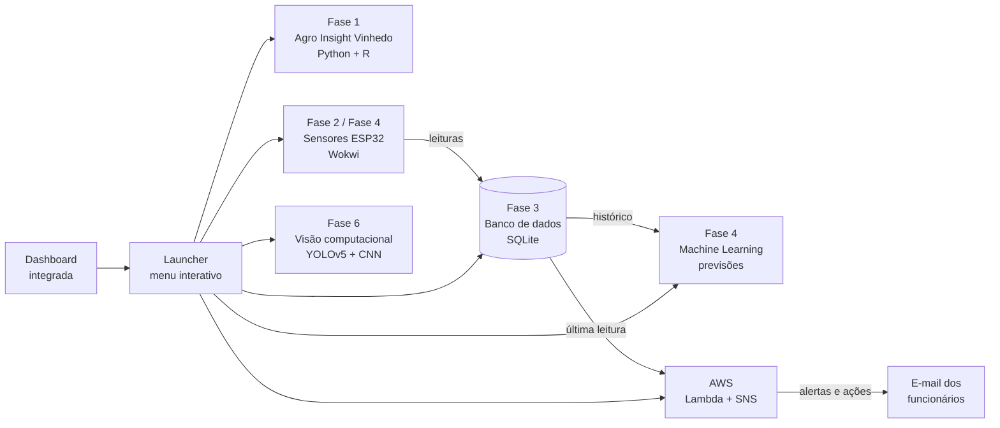
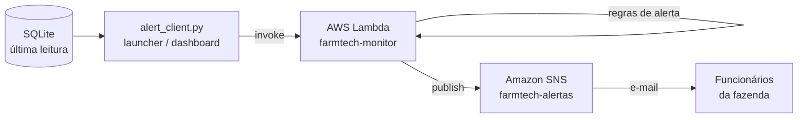

# FIAP - Faculdade de Informática e Administração Paulista

<p align="center">
<a href= "https://www.fiap.com.br/"></a>
</p>

<br>

# FarmTech Solutions - Sistema Agro Integrado

## Grupo

## 👨‍🎓 Integrantes: 
- <a href="https://www.linkedin.com/in/renatoruizcai">Renato Ruiz Cai</a>

## 👩‍🏫 Professores:
### Tutor(a) 
- <a href="https://www.linkedin.com/in/sabrina-otoni-22525519b">Sabrina Otoni</a>
### Coordenador(a)
- <a href="https://www.linkedin.com/in/andregodoichiovato">André Godoi Chiovato</a>


## 📜 Descrição

*O FarmTech Solutions - Sistema Agro Integrado reúne, em um único projeto, os serviços desenvolvidos ao longo das Fases 1 a 6 do curso de **Tecnologia em Inteligência Artificial**, consolidando a solução de agricultura digital construída para a fazenda acompanhada pela FarmTech Solutions.*

*O sistema integra a base de dados e as análises iniciais em Python e R (Fase 1), os sensores IoT com ESP32 e a irrigação automática (Fase 2), o banco de dados estruturado (Fase 3), a dashboard com modelos preditivos de Machine Learning (Fase 4), a infraestrutura em nuvem na AWS (Fase 5) e a visão computacional com YOLOv5 e CNN (Fase 6).*

*Todos os serviços são disparados a partir de um ponto único: um **launcher** na raiz do projeto, utilizado pelo terminal por meio de um menu interativo organizado por fase, e uma **dashboard integrada**, evolução da dashboard da Fase 4, que permite executar cada serviço por botão.*

*Complementarmente, o projeto adiciona um **serviço de alerta na AWS**: uma função AWS Lambda monitora as leituras dos sensores e, ao identificar condições críticas, envia por e-mail, via Amazon SNS, os alertas e as ações corretivas sugeridas aos funcionários da fazenda.*

*O foco desta etapa é a consolidação e a integração: os serviços originais de cada fase foram preservados em suas pastas, com adaptações pontuais para que funcionem em conjunto, compartilhando o mesmo ambiente, a mesma configuração e o mesmo banco de dados.*

*A descrição detalhada de cada serviço está disponível no README de sua respectiva fase.*


## 📁 Estrutura de pastas

Dentre os arquivos e pastas presentes na raiz do projeto, definem-se:

- <b>fase1 a fase6</b>: Pastas com os projetos desenvolvidos em cada fase do curso, cada um com seu próprio README descritivo (ver seção Projeto Principal).

- <b>launcher.py</b>: Ponto único de execução do sistema integrado. Contém o registro de todos os serviços das fases, o menu interativo por fase e os comandos de terminal para disparar cada serviço.

- <b>dashboard</b>: Dashboard integrada em Streamlit, evolução da dashboard da Fase 4.
   - <code>app.py</code>: ponto de entrada da dashboard e navegação entre as páginas.
   - <code>common.py</code>: funções compartilhadas pelas páginas (status do sistema, acesso ao banco e ao launcher).
   - <code>views</code>: páginas da dashboard: Visão geral, Sensores e previsões, Serviços, Visão computacional e Alertas AWS.

- <b>aws_alerts</b>: Serviço de alerta na AWS.
   - <code>lambda_function.py</code>: código da função AWS Lambda <code>farmtech-monitor</code>, responsável por avaliar as leituras, aplicar as regras de alerta e publicar a mensagem no Amazon SNS.
   - <code>alert_client.py</code>: cliente local que obtém a leitura no banco de dados e invoca a Lambda na AWS.
   - <code>test_event.json</code>: evento de exemplo para testar a Lambda diretamente no console da AWS.

- <b>data</b>: Pasta gerada automaticamente com o banco de dados SQLite compartilhado entre as fases (<code>agro_sensors.db</code>). Não é versionada.

- <b>requirements.txt</b>: Dependências Python do sistema integrado (Fases 1 a 4, dashboard e alertas AWS).

- <b>requirements-vision.txt</b>: Dependências adicionais da visão computacional da Fase 6 (PyTorch, YOLOv5 e TensorFlow). Inclui também o <code>requirements.txt</code>.

- <b>.env.example</b>: Modelo das variáveis de ambiente do sistema integrado (OpenWeather, banco de dados, porta serial, credenciais AWS e certificados SSL).

- <b>.env</b>: Arquivo local com as variáveis de ambiente e credenciais. Não é versionado.

- <b>.gitignore</b>: Define os arquivos locais que não devem ser versionados, como credenciais, banco de dados, ambiente virtual, builds do PlatformIO e resultados gerados.

- <b>README.md</b>: Arquivo que apresenta uma visão geral do sistema integrado, incluindo sua finalidade, estrutura e instruções de uso.


## 📌 Projeto Principal

*A descrição completa de cada projeto inclui arquitetura, implementação e documentação detalhada.*

*Fase 1 está disponível em: **fiapCursoTecIA/fase1/fiapAgroInsightVinhedo**.*

*Fase 2 está disponível em: **fiapCursoTecIA/fase2/cap1/fiapAgroSensorsVinhedo**.*

*Fase 3:*
- *Dashboard em Python (Ir Além - Opção 1) está disponível em: **fiapCursoTecIA/fase3/cap1/fiapAgroSensorsDashboard**.*
- *Consulta em Banco de Dados (Entrega Obrigatória) está disponível em: **fiapCursoTecIA/fase3/cap1/fiapAgroSensorsDashboard/scripts/README.md**.*

*Fase 4 está disponível em: **fiapCursoTecIA/fase4/cap1/fiapAgroSensorsIntelligence**.*

*Fase 5 está disponível em: **fiapCursoTecIA/fase5/cap1/fiapAgroAnalytics**.*

*Fase 6 está disponível em: **fiapCursoTecIA/fase6/cap1/fiapAgroNeuralNetwork**.*

*Sistema integrado (Fase 7), disponível na raiz do repositório:*
- *Launcher e menu interativo: **fiapCursoTecIA/launcher.py**.*
- *Dashboard integrada: **fiapCursoTecIA/dashboard**.*
- *Serviço de alerta na AWS: **fiapCursoTecIA/aws_alerts**.*


## 🧩 Arquitetura do Sistema Integrado

*O sistema é organizado em torno de um banco de dados único e de um ponto central de execução. As leituras dos sensores alimentam o banco, que serve de base para os modelos de Machine Learning, para a dashboard e para o serviço de alerta na nuvem.*



*Princípios adotados na integração:*

- *Cada fase permanece em sua própria pasta, com o código original preservado e adaptações apenas onde necessário para o funcionamento conjunto.*
- *O launcher concentra o conhecimento de como executar cada serviço (pasta, comando, dependências e variáveis de ambiente). A dashboard reutiliza essas mesmas definições, sem duplicar lógica.*
- *Um único banco de dados SQLite, um único arquivo <code>.env</code> e um único ambiente Python atendem a todas as fases.*


## 🧭 Launcher e Menu Interativo

*O <code>launcher.py</code> é o ponto de entrada do sistema pelo terminal. Ao ser executado sem argumentos, apresenta um menu interativo organizado por fase:*

```
======================================
 FARMTECH - SISTEMA INTEGRADO
======================================
1 - Fase 1 (Agro Insight Vinhedo)
2 - Fase 2 (Agro Sensors Vinhedo)
3 - Fase 3 (Agro Sensors Dashboard)
4 - Fase 4 (Agro Sensors Intelligence)
5 - Fase 6 (Agro Neural Network)
6 - Alertas AWS (FarmTech Monitor)
7 - Dashboard (Sistema Integrado)
0 - Sair
```

*Ao selecionar uma fase, são exibidos os serviços disponíveis:*

| Fase | Serviço | Comando no terminal |
|---|---|---|
| Fase 1 | Menu de culturas e insumos (interativo) | `python launcher.py run fase1-menu` |
| Fase 1 | Estatísticas agrícolas (R) | `python launcher.py run fase1-estatisticas` |
| Fase 1 | Relatório meteorológico (R) | `python launcher.py run fase1-clima` |
| Fase 2 | Previsão de chuva (OpenWeather) | `python launcher.py run fase2-previsao-chuva` |
| Fase 2 | Compilar firmware ESP32 | `python launcher.py run fase2-firmware` |
| Fase 2 | Ler sensores do ESP32 | `python launcher.py run fase2-leitura` |
| Fase 2 | Menu dos sensores ESP32/Wokwi (interativo) | `python launcher.py run fase2-menu` |
| Fase 3 | Dashboard de irrigação | `python launcher.py run fase3-dashboard` |
| Fase 4 | Inicializar banco SQLite | `python launcher.py run fase4-iniciar-banco` |
| Fase 4 | Importar leituras simuladas | `python launcher.py run fase4-importar-csv` |
| Fase 4 | Limpar banco e reimportar CSV | `python launcher.py run fase4-reimportar-csv` |
| Fase 4 | Treinar modelos de ML | `python launcher.py run fase4-treinar` |
| Fase 4 | Executar previsão agrícola | `python launcher.py run fase4-prever` |
| Fase 4 | Compilar firmware ESP32 | `python launcher.py run fase4-firmware` |
| Fase 4 | Menu dos sensores ESP32/Wokwi (interativo) | `python launcher.py run fase4-menu` |
| Fase 4 | Dashboard preditiva | `python launcher.py run fase4-dashboard` |
| Fase 6 | YOLOv5 adaptado (60 épocas) | `python launcher.py run fase6-yolo-60` |
| Fase 6 | YOLOv5 adaptado (30 épocas) | `python launcher.py run fase6-yolo-30` |
| Fase 6 | YOLOv5 padrão (COCO) | `python launcher.py run fase6-yolo-coco` |
| Fase 6 | CNN construída do zero | `python launcher.py run fase6-cnn` |
| Alertas AWS | Enviar alerta da última leitura | `python launcher.py run alertas-ultima-leitura` |
| Alertas AWS | Enviar alerta de teste (leitura crítica) | `python launcher.py run alertas-teste` |
| Alertas AWS | Prévia do alerta da última leitura | `python launcher.py run alertas-previa` |
| Dashboard | Dashboard integrada | `python launcher.py dashboard` |

*Outros comandos úteis:*

- *`python launcher.py list`: lista todos os serviços disponíveis.*
- *Argumentos extras são repassados ao serviço, por exemplo: `python launcher.py run fase6-cnn --source minha_imagem.jpg`.*

*Antes de executar um serviço, o launcher verifica suas dependências (programas como `Rscript` e `pio`, pacotes Python e variáveis do `.env`) e informa o que está faltando, sem interromper o menu.*


## 📊 Dashboard Integrada

*A dashboard integrada é a evolução da dashboard da Fase 4, agora posicionada na raiz do projeto para representar o sistema completo. Ela pode ser aberta pelo menu (opção 7) ou pelo comando `python launcher.py dashboard`, e fica disponível em `http://localhost:8501`.*

*A dashboard é composta por cinco páginas:*

- ***Visão geral**: apresenta o status do sistema (quantidade de leituras no banco, modelos de Machine Learning treinados, modelos de visão computacional disponíveis e configuração da AWS), o diagrama do fluxo de dados entre as fases e a lista de todos os serviços com seus comandos de terminal.*

- ***Sensores e previsões**: reúne o conteúdo da dashboard da Fase 4, com as métricas da base de dados, a última leitura registrada, as métricas dos modelos de regressão, as correlações entre as variáveis, as previsões agrícolas e a tendência de produtividade. O código da Fase 4 é reutilizado diretamente, sem duplicação.*

- ***Serviços**: permite disparar cada serviço das fases por botão, organizado em abas por fase:*
   - *tarefas (scripts R, previsão de chuva, compilação do firmware, treinamento, previsão etc.) são executadas e têm a saída exibida na própria página;*
   - *as dashboards das Fases 3 e 4 podem ser iniciadas e encerradas, com o link de acesso;*
   - *os menus interativos das Fases 1, 2 e 4, que dependem do teclado no terminal, exibem o comando pronto para execução;*
   - *a leitura dos sensores do ESP32 da Fase 2 pode ser executada por botão, desde que o simulador Wokwi da fase esteja em execução;*
   - *operações destrutivas, como limpar o banco de dados, exigem confirmação antes da execução.*

- ***Visão computacional**: executa os modelos da Fase 6 (YOLOv5 adaptado de 30 e 60 épocas, YOLOv5 padrão e CNN) sobre todas as imagens de teste, sobre uma imagem específica ou sobre uma imagem enviada pelo usuário, com ajuste da confiança mínima das detecções. Os resultados são exibidos em tabela e nas imagens anotadas.*

- ***Alertas AWS**: apresenta a última leitura do banco com os alertas identificados, a prévia do e-mail e o botão de envio. Inclui também a simulação de leituras, em que os valores dos sensores podem ser ajustados para gerar e enviar novos alertas em tempo real.*

*Os modelos de visão computacional são executados em processos separados, por meio do launcher, mantendo a dashboard leve e evitando o carregamento do PyTorch e do TensorFlow na interface.*


## 🔔 Serviço de Alerta na AWS

*O serviço de alerta monitora os dados dos sensores e avisa os funcionários da fazenda por e-mail sempre que identifica condições que exigem ação.*



*O fluxo funciona da seguinte forma:*

1. *O cliente local obtém a leitura mais recente do banco de dados (ou uma leitura simulada) e a envia à Lambda.*
2. *A Lambda <code>farmtech-monitor</code> avalia a leitura com base nas regras definidas pelo grupo.*
3. *Se houver problemas, a Lambda publica no tópico SNS <code>farmtech-alertas</code> uma mensagem com a leitura, os alertas e as ações corretivas sugeridas.*
4. *O Amazon SNS entrega a mensagem por e-mail aos funcionários inscritos no tópico.*
5. *Se a leitura estiver dentro dos parâmetros, nenhum e-mail é enviado.*

### Regras de Alerta e Ações Corretivas

*As regras utilizam os mesmos limites do firmware do ESP32 da Fase 4 (<code>recommendation_engine.cpp</code>), mantendo a consistência entre as decisões tomadas no campo e na nuvem.*

| Condição | Nível | Ação corretiva sugerida |
|---|---|---|
| pH abaixo de 5.5 | CRÍTICO | Realizar calagem (aplicação de calcário) e suspender a irrigação até a correção do solo |
| pH acima de 7.0 | CRÍTICO | Aplicar corretivo acidificante (enxofre elementar ou matéria orgânica) e suspender a irrigação |
| Nutrientes abaixo de 50% | ATENÇÃO | Realizar adubação NPK conforme a análise de solo antes de retomar a irrigação |
| Umidade do solo abaixo de 25% | CRÍTICO | Acionar a irrigação imediatamente e verificar bomba, válvulas e linhas de gotejamento |
| Umidade do solo entre 25% e 40% | ATENÇÃO | Programar irrigação no próximo ciclo, no início da manhã ou no fim da tarde |
| Temperatura ≥ 35 °C e umidade do ar ≤ 35% | ATENÇÃO | Reforçar o monitoramento da umidade do solo e evitar irrigar nos horários mais quentes |
| Produtividade esperada abaixo de 40 | ATENÇÃO | Agendar vistoria técnica no talhão para revisar as condições agronômicas |

*Quando o pH ou os nutrientes estão inadequados, os alertas de umidade orientam a irrigar somente após a correção do solo, seguindo a mesma lógica de bloqueio de irrigação da Fase 4.*

### Recursos na AWS

| Recurso | Nome | Função |
|---|---|---|
| Amazon SNS (tópico Standard) | `farmtech-alertas` | Envio dos e-mails aos funcionários inscritos |
| AWS Lambda (Python 3.12) | `farmtech-monitor` | Avaliação das leituras e publicação dos alertas |
| IAM (usuário programático) | `farmtech-app` | Credencial do sistema local, com permissão apenas para invocar a Lambda |

*Exemplo de e-mail recebido:*

```
Assunto: [FarmTech] CRITICO: 5 alertas na lavoura

Fazenda FarmTech - Vinhedo/SP
Alerta automático do sistema de monitoramento da lavoura

LEITURA DOS SENSORES
--------------------------------------
Umidade do solo: 22.0%
pH do solo: 4.8
Nível de nutrientes: 35.0%
...

ALERTAS E AÇÕES CORRETIVAS
--------------------------------------
1. [CRÍTICO] pH do solo ácido (4.8). Faixa ideal: 5.5 a 7.0.
   Ação sugerida: Realizar calagem (aplicação de calcário) no talhão e suspender a irrigação até a correção do solo.
...
```

*O serviço utiliza apenas recursos incluídos no nível gratuito permanente da AWS: até 1 milhão de requisições mensais no Lambda, e até 1 milhão de publicações e 1.000 entregas de e-mail mensais no SNS.*


## 📎 Links e Observações

- <b>Listagem de Links</b>: Links do projeto (ex. vídeos da entrega, páginas, etc.),
   - Vídeo demonstrativo: [Assistir no YouTube](https://youtu.be/O_DlnDdD1B8)

- <b>Explicação de decisões técnicas</b>:
   - O sistema integrado foi construído no próprio repositório das fases, mantendo cada projeto em sua pasta original. As adaptações foram feitas de forma pontual, priorizando a consolidação e a integração em vez da reescrita dos serviços.
   - O <code>launcher.py</code> foi criado como ponto único de execução. Ele registra cada serviço com sua pasta, comando, tipo de execução (tarefa, menu interativo ou servidor), dependências e variáveis de ambiente, sendo reutilizado tanto pelo menu do terminal quanto pela dashboard.
   - O banco de dados Oracle, utilizado nas Fases 3 e 4, foi substituído pelo SQLite, em razão da perda de acesso ao ambiente Oracle da FIAP. O SQLite é nativo do Python, dispensa servidor e credenciais e armazena o banco em um único arquivo (<code>data/agro_sensors.db</code>), compartilhado por todas as fases e reproduzível por qualquer pessoa que clone o repositório. A estrutura da tabela <code>sensor_readings</code> foi mantida, com a adaptação dos tipos de dados e das consultas (ex.: <code>LIMIT</code> no lugar de <code>FETCH FIRST</code> e ordenação pelo identificador do registro).
   - Na Fase 4, os caminhos relativos foram substituídos por caminhos absolutos baseados na localização de cada arquivo, permitindo executar os serviços a partir da raiz do projeto. Também foram adicionados pontos de entrada diretos para a importação do CSV e para a execução das previsões.
   - A importação do CSV simulado da Fase 4 passou a ser protegida contra duplicidade: se os dados já estiverem no banco, a importação é ignorada. Foi criada a opção de limpar o banco e reimportar o CSV, com confirmação, evitando registros duplicados que distorceriam as métricas dos modelos, já que cópias de uma mesma leitura poderiam aparecer simultaneamente nos conjuntos de treino e de teste.
   - A dashboard da Fase 4 foi reorganizada em funções, continuando a funcionar de forma independente e passando a ser reutilizada como página da dashboard integrada.
   - A leitura serial da Fase 4 passou a aceitar a porta configurável pela variável <code>SENSOR_SERIAL_PORT</code> e a orientar o usuário quando o simulador Wokwi não está em execução.
   - A Fase 2 ganhou um leitor dos sensores em Python (<code>scripts/serial_monitor.py</code>), equivalente ao menu da Fase 4. Sem alterar o firmware, o arquivo <code>wokwi.toml</code> da fase passou a expor a porta serial <code>rfc2217://localhost:4001</code>, diferente da porta 4000 da Fase 4, para que cada leitor se conecte somente ao ESP32 da sua fase. O leitor interpreta o ciclo enviado pelo ESP32 (clima, modelo em R, NPK, pH, umidade, temperatura, decisão de irrigação e bomba) e permite enviar os comandos de simulação já aceitos pelo firmware (previsão de chuva e decisão do modelo em R).
   - A visão computacional da Fase 6, originalmente executada no Google Colab, ganhou um serviço de inferência local (<code>src/vision_service.py</code>). Os pesos treinados (<code>best.pt</code> de 30 e 60 épocas e a CNN em formato <code>.keras</code>) e as imagens de teste foram incorporados ao repositório. Os arquivos <code>last.pt</code>, utilizados apenas para continuar treinamentos, não são versionados.
   - Os pesos do YOLOv5 foram treinados no Colab com Python 3.13, cuja organização interna do módulo <code>pathlib</code> difere da versão 3.12 utilizada localmente. Foi implementada uma camada de compatibilidade temporária durante o carregamento dos pesos, que também permite a execução em Windows.
   - Para a CNN, que classifica a imagem inteira sem localizar o objeto, as imagens de resultado recebem uma faixa com a classe prevista e a confiança, verde quando a classificação está correta e vermelha quando está incorreta, utilizando o prefixo do nome do arquivo como classe real, conforme a regra adotada no notebook.
   - As dependências foram divididas em <code>requirements.txt</code> e <code>requirements-vision.txt</code>, pois o PyTorch e o TensorFlow são pesados e necessários apenas para a Fase 6. Recomenda-se o Python 3.12, já que o TensorFlow pode não estar disponível para as versões mais recentes do Python.
   - As configurações de todas as fases foram centralizadas em um único arquivo <code>.env</code> na raiz. O launcher localiza automaticamente o PlatformIO instalado pela extensão do VS Code e permite configurar um pacote de certificados SSL (<code>SSL_CERT_FILE</code>), necessário quando o Python instalado no macOS não possui os certificados raiz configurados.
   - O serviço de alerta utiliza AWS Lambda e Amazon SNS. A avaliação das leituras foi colocada na Lambda para que o monitoramento ocorra na nuvem, cabendo ao sistema local apenas o envio dos dados. O canal escolhido foi o e-mail, incluído no nível gratuito do SNS, diferentemente do SMS.
   - Na Fase 5, a região de São Paulo (sa-east-1) foi escolhida pela premissa de restrição legal de armazenamento dos dados no exterior e pela latência. A conta AWS utilizada nesta fase foi criada no novo formato de cadastro da AWS, organizado em projetos, que define a região a partir do país de contato e posiciona as contas do Brasil em US East (Ohio, us-east-2), sem permitir a alteração. A premissa legal da Fase 5 permanece respeitada, pois o serviço de alerta não armazena dados dos sensores na nuvem: a Lambda processa a leitura em memória, o SNS apenas entrega a notificação e o histórico permanece no banco de dados local. Para o envio de alertas por e-mail, a diferença de latência não é relevante.
   - Nesse formato de conta, a AWS aplica automaticamente a política gerenciada PowerUserAccess às funções do projeto. Em uma conta tradicional, a boa prática seria conceder à Lambda apenas a permissão <code>sns:Publish</code> no tópico <code>farmtech-alertas</code>. O usuário IAM <code>farmtech-app</code>, utilizado pelo sistema local, recebeu somente a permissão <code>lambda:InvokeFunction</code> na função <code>farmtech-monitor</code>, e suas credenciais ficam apenas no arquivo <code>.env</code>, que não é versionado.
   - Os alertas são enviados sob demanda, pelo launcher ou pela dashboard, e não a cada leitura da ingestão automática. Essa decisão evita o envio excessivo de e-mails e o consumo da cota gratuita do SNS, permitindo alterar os sensores e enviar novos alertas durante a demonstração.
   - Na dashboard integrada, os serviços são executados em processos separados por meio do launcher. Os menus interativos das Fases 1, 2 e 4, que dependem do teclado no terminal, são apresentados com o comando de execução em vez de um botão.


## 🔧 Como executar o código

***Pré Requisitos:***

*Git - Utilizado para clonar o repositório do projeto.*

*Visual Studio Code (VS Code)*

*Extensões do VS Code: Python, PlatformIO IDE e Wokwi Simulator*

*Python 3.12 (recomendado para a compatibilidade com o TensorFlow da Fase 6)*

*R, com o pacote `jsonlite` instalado (Fases 1 e 2)*

*Chave de API do OpenWeather (Fase 2)*

*Conta AWS com os recursos do serviço de alerta configurados (ver passo 4)*

***Passo 1 — Clonar o repositório:***

*No terminal, execute: `git clone git@github.com:renatoruiz2607/fiapCursoTecIA.git`*

*Em seguida, acesse a pasta principal e abra-a no VS Code:*

*cd fiapCursoTecIA*

*code .*

***Passo 2 — Preparar o ambiente Python:***

*Na raiz do projeto, crie e ative o ambiente virtual:*

*`python3.12 -m venv .venv`*

*`source .venv/bin/activate` (no Windows: `.venv\Scripts\activate`)*

*Instale as dependências:*

*`pip install -r requirements-vision.txt` (sistema completo, incluindo a visão computacional da Fase 6)*

*ou `pip install -r requirements.txt` (sistema sem a visão computacional)*

*No VS Code, execute `>Python: Select Interpreter` e selecione o ambiente `.venv`, para que os novos terminais já abram com o ambiente ativado.*

***Passo 3 — Configurar as variáveis de ambiente:***

*Copie o arquivo de exemplo: `cp .env.example .env`*

*Preencha no `.env` a chave `OPENWEATHER_API_KEY`.*

*Se as chamadas às APIs falharem com `CERTIFICATE_VERIFY_FAILED` no macOS, exporte os certificados do sistema e informe o caminho completo em `SSL_CERT_FILE`:*

*`mkdir -p ~/.certs`*

*`security find-certificate -a -p /System/Library/Keychains/SystemRootCertificates.keychain /Library/Keychains/System.keychain > ~/.certs/macos_ca_bundle.pem`*

***Passo 4 — Configurar o serviço de alerta na AWS:***

*No console da AWS, na região da conta:*

1. *No Amazon SNS, crie um tópico do tipo Standard chamado `farmtech-alertas` e uma assinatura com o protocolo E-mail para cada funcionário. Confirme a assinatura pelo link recebido por e-mail.*
2. *No AWS Lambda, crie a função `farmtech-monitor` com o runtime Python 3.12 e cole o conteúdo de `aws_alerts/lambda_function.py`. Em Configuração, adicione a variável de ambiente `ALERT_TOPIC_ARN` com o ARN do tópico, ajuste o tempo limite para 10 segundos e garanta que a função tenha a permissão `sns:Publish` no tópico.*
3. *Teste a função na aba Testar, utilizando o conteúdo de `aws_alerts/test_event.json`.*
4. *No IAM, crie o usuário `farmtech-app`, sem acesso ao console, com uma política que permita apenas `lambda:InvokeFunction` na função `farmtech-monitor`. Gere uma chave de acesso do tipo "Aplicação em execução fora da AWS".*
5. *Preencha no `.env`: `AWS_ACCESS_KEY_ID`, `AWS_SECRET_ACCESS_KEY`, `AWS_DEFAULT_REGION` (região da conta, ex.: `us-east-2`) e `ALERT_LAMBDA_NAME=farmtech-monitor`.*

***Passo 5 — Executar o menu interativo:***

*Na raiz do projeto, com o ambiente ativado, execute: `python launcher.py`*

*Para preparar a base de dados e os modelos, acesse a opção 4 (Fase 4) e execute, nesta ordem:*

- *1 - Inicializar banco SQLite*
- *2 - Importar leituras simuladas*
- *4 - Treinar modelos de ML*

*A partir daí, todos os serviços das fases podem ser executados pelo menu, e a dashboard integrada pode ser aberta pela opção 7.*

***Passo 6 — Executar os sensores ESP32 no Wokwi:***

*Os firmwares das Fases 2 e 4 são simulados no Wokwi, dentro do VS Code. Como o projeto é aberto pela raiz, é necessário indicar qual configuração do Wokwi será utilizada.*

*ESP32 da Fase 4 (sensores integrados ao banco de dados e aos alertas):*

1. *No launcher, acesse 4 (Fase 4) e execute 6 - Compilar firmware ESP32.*
2. *No VS Code, abra a paleta de comandos (Cmd+Shift+P no macOS ou Ctrl+Shift+P no Windows) e execute `>Wokwi: Select Config File`.*
3. *Selecione o arquivo `fase4/cap1/fiapAgroSensorsIntelligence/wokwi.toml`.*
4. *Execute `>Wokwi: Start Simulator` e mantenha a simulação em execução.*
5. *No launcher, acesse 4 (Fase 4) e execute 7 - Menu dos sensores. O menu lê os sensores simulados pela porta `rfc2217://localhost:4000` e permite exibir a leitura atual, salvá-la no banco de dados e iniciar a ingestão automática.*

*ESP32 da Fase 2 (irrigação automática):*

1. *No launcher, acesse 2 (Fase 2) e execute 2 - Compilar firmware ESP32. A compilação gera automaticamente os dados de previsão de chuva e do modelo em R utilizados pelo firmware.*
2. *No VS Code, execute `>Wokwi: Select Config File` e selecione `fase2/cap1/fiapAgroSensorsVinhedo/wokwi.toml`.*
3. *Execute `>Wokwi: Start Simulator` e mantenha a simulação em execução.*
4. *No launcher, acesse 2 (Fase 2) e execute 4 - Menu dos sensores. O menu lê o ESP32 pela porta `rfc2217://localhost:4001` e permite exibir a leitura atual (clima, modelo em R, NPK, pH, umidade, temperatura e decisão de irrigação), monitorar as próximas leituras e enviar os comandos de previsão de chuva e de decisão do modelo em R.*

*Na primeira utilização, o Wokwi pode solicitar a ativação de uma licença gratuita pelo comando `>Wokwi: Request a New License`.*

***Passo 7 — Fluxo completo de ponta a ponta:***

1. *Com o simulador da Fase 4 em execução, altere os potenciômetros do circuito no Wokwi (ex.: reduza o pH para fora da faixa ideal).*
2. *No menu dos sensores da Fase 4, salve a leitura atual no banco de dados e retorne ao launcher.*
3. *Acesse 6 (Alertas AWS) e execute 3 - Prévia do alerta da última leitura para conferir os alertas identificados.*
4. *Execute 1 - Enviar alerta da última leitura. O e-mail com os alertas e as ações corretivas é enviado aos funcionários inscritos no tópico SNS.*
5. *Abra a dashboard integrada (opção 7) para acompanhar a nova leitura, as previsões, os serviços, a visão computacional e os alertas.*


## 📋 Licença

<p xmlns:cc="http://creativecommons.org/ns#" xmlns:dct="http://purl.org/dc/terms/"><a property="dct:title" rel="cc:attributionURL" href="https://github.com/agodoi/template">MODELO GIT FIAP</a> por <a rel="cc:attributionURL dct:creator" property="cc:attributionName" href="https://fiap.com.br">Fiap</a> está licenciado sobre <a href="http://creativecommons.org/licenses/by/4.0/?ref=chooser-v1" target="_blank" rel="license noopener noreferrer" style="display:inline-block;">Attribution 4.0 International</a>.</p>
