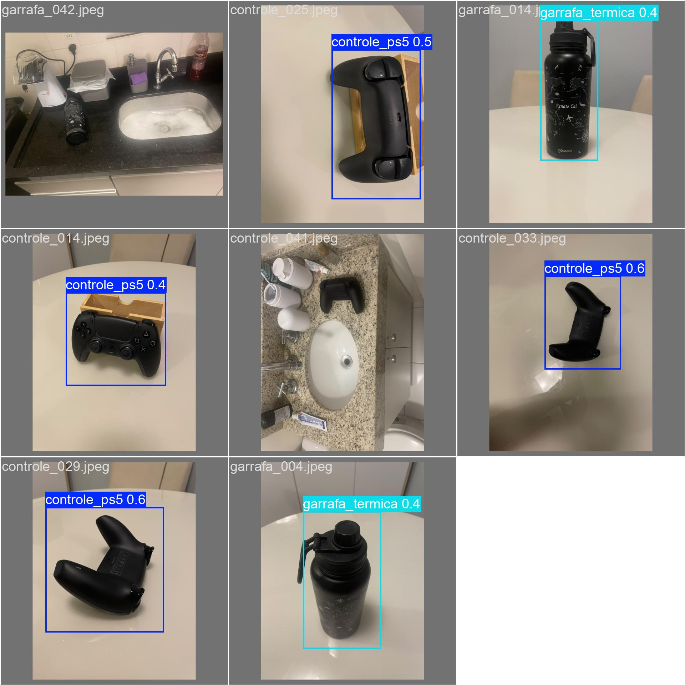
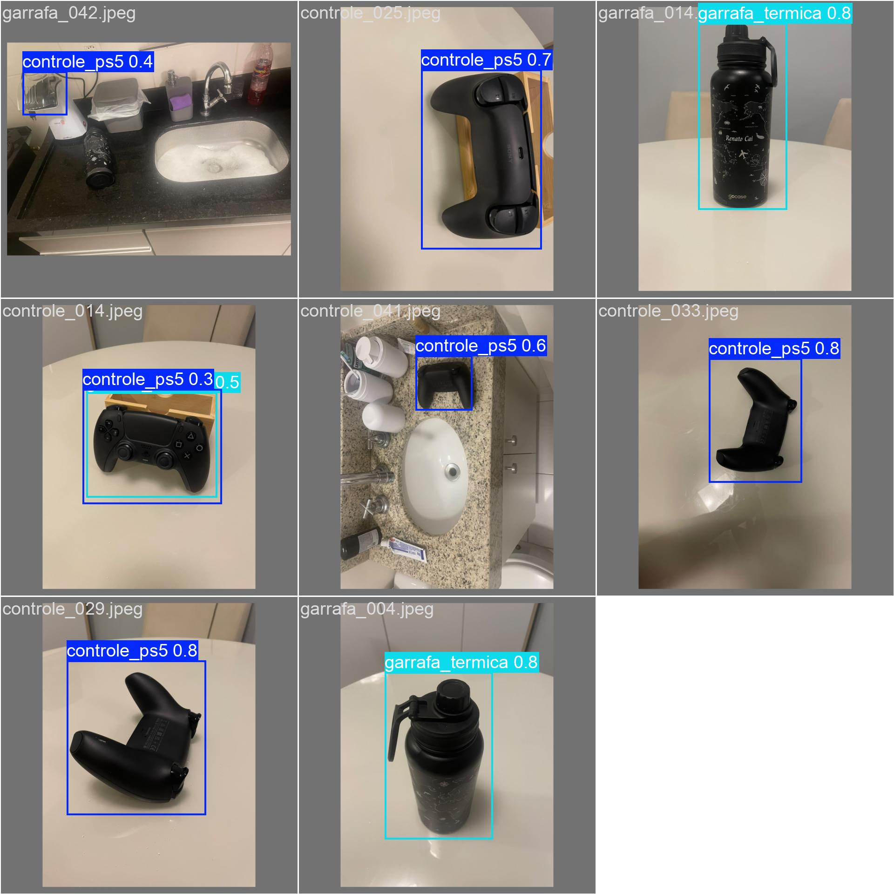
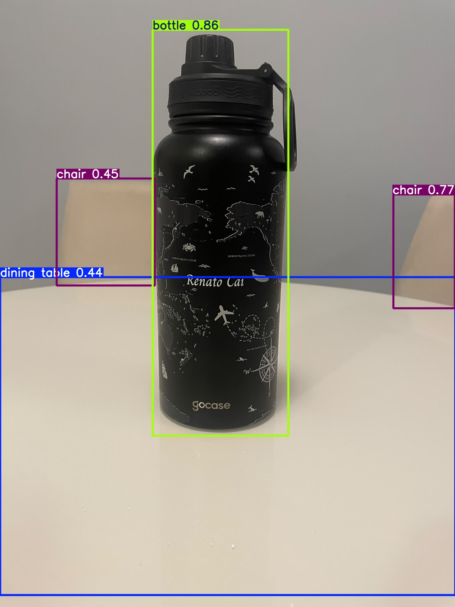
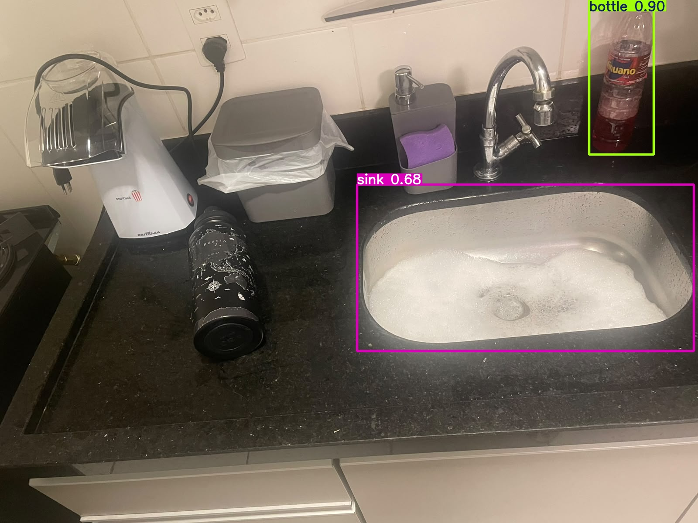

# FIAP - Faculdade de Informática e Administração Paulista

 

# Agro Neural Network

## Grupo

## 👨‍🎓 Integrantes: 
- <a href="https://www.linkedin.com/in/renatoruizcai">Renato Ruiz Cai</a>

## 👩‍🏫 Professores:
### Tutor(a) 
- <a href="https://www.linkedin.com/in/sabrina-otoni-22525519b/">Sabrina Otoni</a>
### Coordenador(a)
- <a href="https://www.linkedin.com/in/andregodoichiovato">André Godoi Chiovato</a>

## 📜 Descrição

*Este projeto apresenta uma aplicação prática de Visão Computacional, explorando diferentes abordagens de Inteligência Artificial para reconhecer dois objetos do cotidiano: um controle de PlayStation 5 (PS5) e uma garrafa térmica.*

*A proposta é investigar como diferentes modelos de aprendizado profundo (Deep Learning) interpretam imagens e identificam objetos, considerando suas características, capacidades e limitações.*

*Para isso, foram utilizadas três abordagens:*

*YOLOv5 adaptável: modelo pré-treinado e posteriormente ajustado com imagens dos objetos selecionados, utilizando treinamentos de 30 e 60 épocas para detectar e localizar os objetos nas imagens.*

*YOLOv5 padrão: modelo utilizado com seus pesos originais, sem treinamento adicional, permitindo observar como uma rede treinada em categorias genéricas reconhece os objetos do projeto.*

*CNN construída do zero: rede neural convolucional desenvolvida especificamente para classificar as imagens entre controle PS5 e garrafa térmica, sem utilizar pesos pré-treinados.*

*O projeto utiliza um conjunto de 94 imagens, distribuídas entre treinamento, validação e teste, permitindo avaliar o comportamento dos modelos em diferentes condições.*

*Além da implementação, o repositório apresenta exemplos visuais das detecções e classificações realizadas, incluindo imagens reconhecidas corretamente, identificações incorretas e situações em que os modelos não conseguiram reconhecer os objetos.*

*O objetivo é demonstrar, de maneira prática, as diferenças entre detecção e classificação de imagens, destacando como o treinamento personalizado influencia o reconhecimento de objetos e como cada abordagem responde aos mesmos dados.*

*A documentação técnica, os procedimentos de treinamento, as métricas e as análises quantitativas estão disponíveis no notebook do Google Colab. Este README concentra-se na apresentação do funcionamento do projeto, na organização dos experimentos e na análise visual dos resultados, complementando o conteúdo técnico do notebook.*

## 📁 Estrutura

Dentre os arquivos presentes na raiz do projeto, definem-se:

- <b>RenatoRuiz_rm572235_pbl_fase6.ipynb</b>: notebook desenvolvido no Google Colab para um projeto de Visão Computacional, utilizando técnicas de Deep Learning para detecção e classificação de controles PS5 e garrafas térmicas. Contempla a preparação e validação de um dataset com 94 imagens, o treinamento e a avaliação de dois modelos YOLOv5s adaptáveis (30 e 60 épocas), a execução do YOLOv5s padrão com pesos pré-treinados no COCO e a construção de uma Rede Neural Convolucional (CNN) do zero com TensorFlow/Keras. Inclui o processamento e a visualização das imagens, a avaliação dos modelos por meio de métricas como Precision, Recall, F1-score, acurácia, mAP e matriz de confusão, além da medição dos tempos de treinamento e inferência. Apresenta análises técnicas e comparativas dos resultados, destacando as diferenças de desempenho, as limitações e as características de cada abordagem..

- <b>README.md</b>: Arquivo que apresenta uma visão geral do projeto, incluindo sua finalidade, estrutura e instruções de uso.

## 📎 Links e Observações

- <b>Listagem de Links</b>: Links do projeto (ex. vídeos da entrega, páginas, etc.),
   - Vídeo demonstrativo do Colab: [Assistir no YouTube](https://youtu.be/60Ev5qUVokM)
   - Google Colab: [Open in Colab](https://colab.research.google.com/github/renatoruiz2607/fiapCursoTecIA/blob/dev/fase6/cap1/fiapAgroNeuralNetwork/RenatoRuiz_rm572235_pbl_fase6.ipynb)

- <b>Explicação de decisões técnicas</b>:
   - O projeto utiliza PyTorch e TensorFlow/Keras para explorar duas abordagens distintas de Visão Computacional: detecção e localização de objetos com YOLOv5 e classificação de imagens com CNN.
   - As imagens foram divididas em 74 para treinamento, 10 para validação e 10 para teste, separando os dados utilizados no aprendizado daqueles empregados na avaliação final dos modelos.
   - O conjunto de teste foi organizado com 5 imagens de cada classe, permitindo avaliar o desempenho individual dos objetos sem favorecer uma categoria pela quantidade de amostras.
   - A comparação com o YOLO padrão permite evidenciar a importância do fine-tuning, especialmente porque a classe controle PS5 não corresponde a uma categoria específica reconhecida pelo modelo original.
   - A CNN foi construída do zero, sem transferência de aprendizado, para avaliar a capacidade de uma arquitetura própria aprender características visuais das duas classes a partir das imagens disponíveis.
   - A CNN utiliza três camadas convolucionais, com 32, 64 e 128 filtros, permitindo extrair características visuais progressivamente mais complexas.
   - As camadas de MaxPooling foram utilizadas para reduzir as dimensões espaciais das representações, diminuindo o custo computacional e preservando características relevantes.
   - O GlobalAveragePooling2D foi adotado antes das camadas densas para reduzir a quantidade de parâmetros em comparação com uma operação de achatamento convencional (Flatten).
   - A camada Dropout de 30% foi incluída como mecanismo de regularização, buscando reduzir o risco de overfitting durante o treinamento da CNN.
   - A camada de saída da CNN utiliza Softmax com dois neurônios, permitindo calcular as probabilidades de classificação entre controle PS5 e garrafa térmica.
   - O otimizador Adam, com taxa de aprendizado de 0,001, foi utilizado na CNN por sua capacidade de ajustar adaptativamente os parâmetros durante o treinamento.
   - As imagens da CNN foram redimensionadas para 128 × 128 pixels, reduzindo o custo computacional e padronizando as entradas da rede neural.
   - O treinamento da CNN foi configurado com 30 épocas e batch size de 8, permitindo avaliar uma arquitetura relativamente simples em condições compatíveis com o tamanho reduzido do dataset.
   - A avaliação do YOLO utilizou Precision, Recall, mAP@0.5 e mAP@0.5:0.95, considerando tanto a capacidade de identificar os objetos quanto a qualidade da localização por meio das bounding boxes.
   - A avaliação da CNN utilizou acurácia, Precision, Recall, F1-score e matriz de confusão, permitindo analisar os acertos e erros de classificação de cada classe.
   - A matriz de confusão foi incluída para identificar quais objetos foram classificados incorretamente, complementando as métricas gerais com uma análise dos tipos de erro.
   - O conjunto reduzido de imagens foi considerado uma limitação experimental, pois pequenas quantidades de erros podem provocar variações significativas nas métricas, especialmente no conjunto de teste com apenas 10 amostras.

## 🔧 Como executar o código

***Pré Requisitos:***

*Crie a arquitetura de pastas no Google Drive:*

dataset {
  images {
    train,
    test,
    val
  },
  labels {
    train,
    test,
    val
  }
}

*Preparar no um dataset com 40 fotos de cada objeto, separando 32 para treino, 4 para teste e 4 para validação.*

*Salve estas imagens na pasta images, separando-as nas pastas train, test e val*

*Enviar essas imagens ao MakeSense.ai, criar as classes dos objetos que quer detectar e rotulá-los de acordo.*

*Ao fim de cada grupo de imagens rotuladas, exporte as anotações (arquivos .txt) e grave na pasta referente ao grupo dentro da pasta labels*

***Funcionamento:***

*Abrir o arquivo `RenatoRuiz_rm572235_pbl_fase6.ipynb`*

*Clicar no botão `Open in Colab`*

*Após isso, no conteúdo principal, cada bloco de código contém um botão executar*

*Vá executando todos de cima abaixo, não pule nenhum, para que tudo rode corretamente.*

*Vale lembrar que todas as descrições e análises são baseadas nas 94 imagens utilizadas e de acordo com o treinamento realizado quando o projeto foi buildado.*

*Todos os indicadores, estatísticas e valores podem mudar a cada build e a cada grupo de imagens.*

## 🔎 Análise visual das detecções

*A visualização das predições do YOLOv5 adaptado com 30 épocas demonstra que o modelo conseguiu identificar e localizar controles PS5 e garrafas térmicas em diferentes perspectivas e ambientes.*

*Das oito imagens apresentadas, seis possuem detecções, sendo quatro controles PS5 e duas garrafas térmicas. As caixas delimitadoras demonstram uma localização visualmente adequada dos objetos, com valores de confiança entre 0,4 e 0,6.*

*Um aspecto positivo foi o reconhecimento dos controles PS5 em diferentes orientações, incluindo imagens da parte frontal e traseira, indicando que o modelo conseguiu aprender características relevantes do objeto.*

*Entretanto, nas imagens controle_041.jpeg e garrafa_042.jpeg, que apresentam cenários com diversos elementos visuais, não foram realizadas detecções. Esse comportamento evidencia possíveis limitações do modelo em ambientes mais complexos.*

*Os resultados demonstram que o treinamento de 30 épocas permitiu ao YOLOv5 aprender a identificar as classes personalizadas e localizar os objetos, embora ainda existam oportunidades de melhoria na confiança das predições e na detecção em diferentes condições visuais.*

  

  <i>Figura 1 — YOLOv5 adaptado (30 épocas)</i>

*O YOLOv5 adaptado com 60 épocas apresentou uma evolução na capacidade de reconhecimento dos objetos em comparação ao treinamento de 30 épocas, demonstrando maior confiança nas predições e conseguindo identificar um controle PS5 que anteriormente não havia sido detectado.*

*Em imagens como `controle_025.jpeg`, `controle_029.jpeg`, `controle_033.jpeg`, `garrafa_014.jpeg` e `garrafa_004.jpeg`, os valores de confiança aumentaram, chegando a 0,8 em algumas detecções. Além disso, o modelo passou a identificar corretamente o controle presente em `controle_041.jpeg`, mesmo em um ambiente com vários elementos visuais.*

*Entretanto, o treinamento adicional também apresentou limitações. Na imagem `garrafa_042.jpeg`, o modelo identificou incorretamente a tampa de um eletrodoméstico como um controle PS5, com confiança de 0,4. Já em `controle_014.jpeg`, além de reconhecer o controle, gerou uma detecção adicional incorreta da classe garrafa térmica.*

*Esses exemplos demonstram que o aumento do número de épocas contribuiu para melhorar a confiança e recuperar algumas detecções, mas não garantiu a eliminação de falsos positivos.*

*De modo geral, a comparação visual indica uma evolução do modelo com 60 épocas, embora evidencie a necessidade de avaliar não apenas a quantidade de detecções e seus níveis de confiança, mas também a correção das classes atribuídas e a ocorrência de identificações indevidas.*

  

  <i>Figura 2 — YOLOv5 adaptado (60 épocas)</i>

*O YOLOv5 padrão, utilizando os pesos originais pré-treinados no dataset COCO, demonstrou capacidade de reconhecer diferentes objetos presentes nas imagens, mesmo sem ter sido adaptado às classes específicas do projeto.*

*Na imagem `garrafa_014.jpeg`, o modelo identificou corretamente todos os objetos principais: uma garrafa térmica, classificada pela categoria genérica `bottle` com confiança de **86%**, duas cadeiras, com confiança de **45%** e **77%**, e uma mesa, identificada como `dining table` com confiança de **44%**. Esse resultado demonstra a capacidade do modelo pré-treinado de reconhecer e localizar múltiplos objetos de categorias diferentes em uma mesma imagem.*

*Entretanto, na imagem `garrafa_042.jpeg`, o comportamento foi diferente. Embora a garrafa térmica estivesse visível sobre a bancada, o modelo não conseguiu identificá-la. Em contrapartida, classificou incorretamente um tubo de detergente como `bottle`, com confiança de **90%**, enquanto identificou corretamente a pia como `sink`, com confiança de **68%**.*

*Esse segundo exemplo evidencia uma limitação importante: um valor elevado de confiança não garante que a identificação esteja correta. Apesar de apresentar **90%** de confiança na classe `bottle`, o modelo atribuiu essa classificação ao objeto errado, deixando de reconhecer a garrafa térmica presente na imagem.*

*A comparação demonstra que o YOLOv5 padrão possui boa capacidade de reconhecimento de objetos genéricos, mas pode apresentar dificuldades diante de diferentes formatos, orientações e contextos visuais. Os resultados reforçam a importância do treinamento personalizado para adaptar o reconhecimento às características específicas dos objetos do projeto.*

  

  <i>Figura 3 — YOLOv5 padrão</i>

  

  <i>Figura 4 — YOLOv5 padrão</i>

## 📝 Conclusão — Qual modelo escolher para cada aplicação?

*Os experimentos demonstraram que não existe um único modelo superior para todas as situações. A escolha depende principalmente dos objetos que o cliente deseja reconhecer, da necessidade de localizá-los na imagem e da disponibilidade de dados para treinamento.*

*Considerando os resultados obtidos, podemos apresentar três cenários de aplicação.*

### Cenário 1 — Monitoramento e contagem de objetos genéricos

***Exemplo de aplicação:** uma fazenda deseja instalar câmeras na passagem do gado para contar automaticamente quantos animais atravessam determinado ponto. Outro exemplo seria um sistema de vigilância que detecta a presença de pessoas em uma área restrita.*

***Modelo recomendado:** YOLOv5 padrão (pré-treinado).*

*O YOLOv5 padrão é uma escolha inicial interessante para esse cenário porque já foi treinado para reconhecer diversas categorias comuns, incluindo pessoas e vacas, sem exigir a criação de um dataset personalizado.*

*Em nossos experimentos, esse modelo demonstrou capacidade de identificar simultaneamente diferentes objetos, como cadeiras, mesas, pias e garrafas, mesmo sem treinamento adicional. Isso evidencia sua utilidade em aplicações que envolvem categorias genéricas.*

### Cenário 2 — Identificação de objetos específicos

***Exemplo de aplicação:** uma empresa deseja automatizar a conferência de estoque por câmeras, identificando especificamente controles PS5 e garrafas térmicas, diferenciando esses produtos de outros objetos presentes no ambiente.*

***Modelo recomendado:** YOLOv5 adaptado com 60 épocas, quando a aplicação exige detectar e localizar os produtos.*

*O YOLOv5 padrão apresentou limitações no reconhecimento de objetos específicos, como o controle PS5. Já os modelos adaptados aprenderam as classes personalizadas, permitindo identificar e localizar os produtos por meio de caixas delimitadoras.*

*Entre os treinamentos realizados, o modelo de 60 épocas apresentou melhor Precision geral no teste (96,0% contra 91,2%) e melhor mAP@0.5:0.95 (63,5% contra 51,1%), indicando melhor desempenho geral na precisão das detecções e na qualidade da localização.*

*Por outro lado, o modelo de 30 épocas apresentou Recall superior (88,1% contra 80,0%) e ligeira vantagem no mAP@0.5 (88,8% contra 87,9%). Portanto, se o objetivo for minimizar objetos não detectados, o modelo de 30 épocas também merece consideração.*

*A análise visual mostrou ainda que o modelo de 60 épocas recuperou algumas detecções ausentes no de 30 épocas, mas apresentou falsos positivos. Isso reforça que o treinamento adicional não garante melhores resultados em todos os casos.*

### Cenário 3 — Classificação de fotografias individuais de produtos

*Se a empresa precisasse apenas classificar fotografias individuais de produtos, sem localizar objetos na imagem, a CNN seria uma alternativa interessante. Ela alcançou 90% de acurácia, com treinamento mais rápido, mas não foi desenvolvida para detectar e contar múltiplos objetos.*

---

## 📋 Licença

<a property="dct:title" rel="cc:attributionURL" href="https://github.com/SabrinaOtoni/TEMPLATE-FIAP-GRAD-ON-IA">MODELO GIT FIAP</a> por <a rel="cc:attributionURL dct:creator" property="cc:attributionName" href="https://fiap.com.br">FIAP</a> está licenciado sobre <a href="http://creativecommons.org/licenses/by/4.0/?ref=chooser-v1" target="_blank" rel="license noopener noreferrer" style="display:inline-block;">Attribution 4.0 International</a>.

